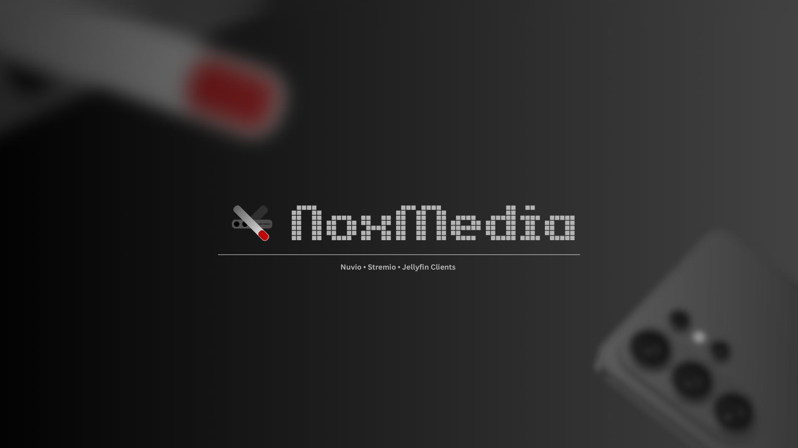

<p align="center">
  
</p>

<p align="center">
  <strong>Transform your Android device into a private, high-performance media server powered by Telegram's infinite cloud storage.</strong>
</p>

<p align="center">
  <a href="https://github.com/TheAceOfficials/NoxMedia/releases"></a>
  <a href="https://kotlinlang.org"></a>
  <a href="https://chaquo.com/chaquopy/"></a>
  <a href="https://stremio.com"></a>
  <a href="https://www.patreon.com/cw/TheAceOfficials"></a>
  <a href="#-license"></a>
</p>

---

## 📑 Table of Contents

- [What is NoxMedia?](#-what-is-noxmedia)
- [Why NoxMedia? (Use-Cases)](#-why-noxmedia-use-cases)
- [Key Features](#-key-features)
- [ZIP Archive Handling & Playback](#-zip-archive-handling--playback)
- [Platform Support & iOS Limitations](#-platform-support--compatibility)
- [Step-by-Step Setup Guide](#-step-by-step-setup-guide)
  - [Step 1: Get Telegram API Credentials](#step-1-get-telegram-api-credentials)
  - [Step 2: Authenticate Account](#step-2-authenticate-account)
  - [Step 3: Connect Monitored Channels](#step-3-connect-monitored-channels)
  - [Step 4: Stream in Stremio / Nuvio](#step-4-stream-in-stremio--nuvio)
  - [Finding Telegram Channel IDs (Private & Public)](#-finding-telegram-channel-ids-private--public)
- [Remote Streaming & Mobile Data Fix (Tailscale)](#-remote-streaming--mobile-data-fix-tailscale)
- [Background Streaming Best Practices](#-background-streaming-best-practices)
- [Support & Sponsorship](#-support--sponsorship)
- [Acknowledgements & Inspiration](#-acknowledgements--inspiration)
- [License](#-license)

---

## 📖 What is NoxMedia?

**NoxMedia** is an advanced, standalone Android application that transforms your smartphone or tablet into a private, self-hosted media streaming server and **Stremio / Nuvio Addon**.

By interfacing directly with Telegram's robust content delivery network via an embedded MTProto bridge, NoxMedia parses, catalogs, enriches, and serves media files stored in your monitored Telegram channels straight to modern media players—with zero-latency byte-range seeking, automatic anime episode mapping, and zero external PC or hosting requirements.

> [!NOTE]
> **Acknowledgement & Roots:**  
> NoxMedia is inspired by the pioneering work of [Telegram-Stremio](https://github.com/weebzone/Telegram-Stremio). While honoring that open-source foundation, NoxMedia has been completely re-architected from the ground up as a native Android-first ecosystem featuring an embedded Python runtime (Chaquopy), a custom multi-part video merge pipeline, an automated Telegram cloud backup system, smart battery management, and a sleek, Nothing OS-inspired Jetpack Compose interface.

---

## 💡 Why NoxMedia? (Use-Cases)

### 1. Unlimited Cloud Media Vault (The Zero-Cost Jellyfin Alternative)
Self-hosting media servers like Plex, Jellyfin, or Emby traditionally requires thousands of dollars in investment: dedicated NAS enclosures, multi-terabyte mechanical hard drives, RAID arrays, and continuous electricity bills. NoxMedia unlocks **Telegram’s virtually unlimited cloud storage** to serve as your personal media library. Upload or forward your 4K HDR movies, anime collections, and series to private channels, and NoxMedia serves them seamlessly on demand.

### 2. Zero Server Overhead & Hardware Independence
No dedicated Linux home lab or Raspberry Pi required. An old spare Android phone or tablet running NoxMedia consumes less than 5 Watts of power while operating 24/7 as an ultra-compact local streaming server on your home network.

### 3. Native Stremio & Nuvio Ecosystem Integration
Install the local addon manifest URL once into **Stremio** or **Nuvio**, and all indexed media appears instantly across your devices—Smart TVs, streaming sticks, laptops, PCs, or tablets—with movie posters, synopsis, season groupings, and episode streams.

---

## ⚡ Key Features

### 🚀 High-Performance Streaming Engine
- **HTTP 206 Partial Content Support:** Built-in byte-range seek engine provides instant scrubbing, fast forward, and rewind identical to local file playback.
- **Dual-Tier Dynamic Caching:** Combines an ultra-fast **48MB in-memory LRU chunk cache** for instant header/index seeks with a configurable on-disk chunk cache (512MB – 8GB).
- **Multi-Part Split Video Assembly:** Automatically discovers and transparently concatenates split archive parts (`part1.mp4`, `part2.mp4` / `pt1`, `pt2`) into a single unified stream on the fly.

### 🧠 Intelligent Catalog & Automation
- **Continuous Auto-Scan:** Automatically discovers and indexes newly uploaded media in monitored channels every 30 seconds without manual syncing.
- **Deduplication & Quality Filter:** Identifies identical content uploaded across channels and provides an automated switch to skip or clean redundant split duplicates and low-quality CAM/TS releases.
- **Dead Link Detection:** Scans for deleted Telegram messages or revoked media and purges inaccessible items from your library automatically.

### 🎨 Rich Metadata & Artwork Enrichment
- **Automated TMDB & TVDB Scraping:** Automatically extracts clean release titles, release years, plot summaries, and backdrops.
- **Kitsu Anime Database Integration:** Built-in absolute numbering support (e.g., *One Piece 1130*, *Bleach 39*) ensuring long-running anime map to correct season/episode structures.
- **SpatialPosters & Custom API Compatibility:** Plug in custom poster providers or third-party artwork APIs for high-resolution graphics.

### ☁️ Automated Telegram Cloud Backup & Cross-Device Restore
- **Telegram Saved Messages Backup:** Automatically backs up all server settings, automation preferences, and monitored channels directly to your Telegram **Saved Messages** (`#NoxMediaBackup`) on a scheduled interval (1h, 2h, 6h, 12h, 24h).
- **Silent Cross-Device Auto-Sync:** When logging into NoxMedia on a new device (e.g., switching to a new phone or tablet), NoxMedia silently detects and restores your channels and preferences from your Telegram cloud backup in seconds.

### 🎙️ Alexa Smart Home Voice Control
- **Hands-Free Control:** Built-in faux Philips Hue bridge allowing you to turn NoxMedia streaming services ON or OFF using Amazon Alexa voice commands (*"Alexa, turn on NoxMedia"*).

### 🔋 Smart Battery & Power Management
- **Auto-Sleep Watchdog:** Configurable inactivity timer that shuts down streaming listeners when no client is playing to maximize battery life on mobile devices.
- **Wi-Fi High-Performance Locks:** Prevents the Android kernel from entering low-power network throttling while a video stream is actively playing.

### 🌐 Remote Access & Mesh Networking
- **Native Tailscale Detection:** Automatically detects your device's Tailscale VPN IP address for secure, out-of-home streaming anywhere in the world.
- **Public Domain Tunneling:** Support for custom reverse proxies and remote URLs (Cloudflare Tunnels, ngrok, VPS proxies).

### 🧪 Jellyfin Bridge Mode
- **Jellyfin Compatibility Layer:** *(Currently on Hold / In Development — Planned for Future Stable Release)* — An experimental bridge architecture allowing native Jellyfin clients and apps to stream directly from NoxMedia's indexed catalog.

---

## 📦 ZIP Archive Handling & Playback

NoxMedia natively scans and parses media files packed inside `.zip` archives directly from Telegram channels without downloading the whole archive or extracting it locally.

> [!IMPORTANT]
> **Direct Streaming Requirement (Store vs. Deflate Compression):**
> * **Uncompressed ZIPs (0% / Store Mode):** Direct real-time streaming and seeking work seamlessly! Because video files (like `.mkv` or `.mp4`) are already internally compressed, saving them into a ZIP using `Store` (no compression) allows NoxMedia to read random byte-ranges on demand directly from Telegram's cloud.
> * **Compressed ZIPs (Deflate):** If a `.zip` archive was created with standard compression, NoxMedia **will detect and catalog** the media file in your library with full posters and metadata, but **real-time playback is not supported**. Compressed ZIP streams do not allow arbitrary byte seeking without decompressing the entire file from the beginning.

---

## 📱 Platform Support & Compatibility

| Platform | Support Status | Notes |
| :--- | :---: | :--- |
| **Android Phones & Tablets** | ✅ **Fully Supported** | Android 7.0 (API 24) to Android 16 (Touchscreen UI) |
| **Android TV / Firestick** | ⚠️ **Untested / No D-Pad UI** | NoxMedia server app is built for touchscreens; no TV D-pad remote navigation yet |
| **Apple iOS (iPhone / iPad)** | ❌ **Not Supported (Host Server)** | Technical architectural limitation (see below) |

> [!TIP]
> **Host Server vs. Playback Clients:**  
> NoxMedia runs as the **server host** on your Android touchscreen device (phone or tablet). However, you can enjoy watching your streams on **any playback screen** (Smart TVs, Fire TV, Apple TV, PC, Mac, iPad) simply by installing **Stremio** or **Nuvio** on that device and connecting your NoxMedia manifest link!

### ❓ Why isn't NoxMedia server available for iOS?
Running a dedicated, 24/7 background media streaming server requires:
1. Long-lived background TCP socket listeners bound to local ports.
2. Uninterrupted background multi-connection networking.
3. Persistent Wi-Fi CPU wake-locks that ignore screen lock states.

**Apple's iOS security architecture strictly forbids long-running background socket servers.** iOS suspends and kills background network tasks within 30 seconds of the device being locked or an app being minimized. While you cannot host the NoxMedia server *on* an iOS device, **you can seamlessly watch NoxMedia streams on iOS** by opening [Stremio Web](https://web.stremio.com) or **Nuvio** on your iPhone/iPad and connecting to your Android phone's NoxMedia manifest URL!

---

## 🚀 Step-by-Step Setup Guide

```
┌────────────────────────┐      ┌───────────────────────────┐      ┌─────────────────────────┐
│ 1. Get API Credentials │ ───▶ │ 2. Log in with Account    │ ───▶ │ 3. Connect Channels     │
│    (my.telegram.org)   │      │    (In-App or Session)    │      │    (Public or Private)  │
└────────────────────────┘      └───────────────────────────┘      └─────────────────────────┘
                                                                                │
                                                                                ▼
                                                                   ┌───────────────────────────┐
                                                                   │ 4. Install Stremio/Nuvio  │
                                                                   │    (manifest.json URL)    │
                                                                   └───────────────────────────┘
```

### Step 1: Get Telegram API Credentials
1. Open any web browser and navigate to [my.telegram.org](https://my.telegram.org).
2. Log in using your Telegram phone number and confirmation code.
3. Tap on **API development tools**.
4. Fill in any App title and short name, then submit.
5. Copy your **`api_id`** (numbers) and **`api_hash`** (32-character string).

### Step 2: Authenticate Account
Open NoxMedia on your Android device and enter your `API ID` and `API Hash`. You have two authentication methods:
- **Direct In-App Login:** Enter your phone number, receive the official code in your Telegram app, and enter it directly.
- **Session String Login:** Paste an existing Pyrogram session string generated via our [Google Colab Notebook](https://colab.research.google.com/github/TheAceOfficials/NoxMedia/blob/main/string_session.ipynb) or via `@StringSessionRobot` in Telegram.

### Step 3: Connect Monitored Channels
1. Navigate to the **Channels** tab.
2. Enter the channel username (e.g., `@MyMoviesChannel`), invite link, or channel ID (e.g., `-1001234567890`).
3. Tap **Connect Channel**. NoxMedia will resolve channel access and begin background media indexing immediately.

### Step 4: Stream in Stremio / Nuvio
1. On the **Home** tab, toggle the server switch to **RUNNING**.
2. Note your local server URL (e.g., `http://192.168.1.50:7788/manifest.json`).
3. Open **Stremio** or **Nuvio** on any TV, PC, phone, or tablet connected to the same Wi-Fi.
4. Install the Addon:
   - **In Stremio:** Go to **Addons** ➔ paste your `manifest.json` URL into the search bar ➔ tap **Install**.
   - **In Nuvio:** Go to **Plugins / Addons** ➔ paste your `manifest.json` URL ➔ save & enable.
5. Browse your movies, series, and anime with full posters, episode streams, and instant seeking!

---

### 🔍 Finding Telegram Channel IDs (Private & Public)

Need the exact channel ID for connecting private channels or configuring your **True Cloud Sync Backup Destination**?

You can easily get the ID of **any Telegram channel** (even private ones without a public `@username`) using these verified Telegram bots:

* **[@idbot](https://t.me/idbot)**
* **[@userinfobot](https://t.me/userinfobot)**

#### How to use:
1. Open [@idbot](https://t.me/idbot) or [@userinfobot](https://t.me/userinfobot) in your Telegram app and tap **Start**.
2. Go to your private or public channel and **forward any message or video** from the channel into the bot chat.
3. Even if the channel is completely private, the bot will instantly reply with the channel's unique ID:
   ```
   Forwarded from chat: Your Channel Name
   ID: -1001234567890
   ```
4. Copy the full ID including the `-100` prefix (e.g., `-1001234567890`) and paste it directly into:
   - **Channels Tab** ➔ To connect and monitor the channel.
   - **Settings Tab ➔ True Cloud Sync ➔ Backup Destination Chat** ➔ To use a private channel as your personal encrypted backup cloud!

---

## 🌐 Remote Streaming & Mobile Data Fix (Tailscale)

### ⚠️ The Mobile Data (4G/5G) Rotating IP Issue
When using NoxMedia over cellular mobile data, your telecom carrier places your device behind **Carrier-Grade NAT (CGNAT)** and dynamically rotates your IP address frequently (whenever switching towers, reconnecting, or toggling airplane mode). 

This causes your local manifest URL (`http://192.168.x.x:7788/manifest.json` or carrier IP) to change or become unreachable by external client apps (like **Nuvio**, **Stremio**, Smart TVs, or laptops), forcing you to repeatedly copy and paste new addon URLs.

### 💡 The Solution: Tailscale Mesh VPN (Permanent 100% Static IP)
[Tailscale](https://tailscale.com) creates a secure, zero-config peer-to-peer virtual private network between all your devices:

1. **Install Tailscale (Free)** on both your NoxMedia host phone and your client devices (Smart TV, laptop, or other phone).
2. Sign in with the **same account** on both devices.
3. Tailscale assigns your NoxMedia Android device a permanent, static **`100.x.y.z`** IP address that **NEVER changes**—even when switching between Wi-Fi and mobile 4G/5G data!
4. NoxMedia automatically detects and displays this Tailscale IP address right on the **Home Screen**.
5. Install your permanent Tailscale manifest link once in Nuvio or Stremio:
   ```
   http://100.x.y.z:7788/manifest.json
   ```
6. Alternatively, enter a Cloudflare Tunnel or reverse-proxy domain into **Settings ➔ Remote Access URL**.

Now your media server stays connected 24/7 without ever needing to update your manifest URL again!

---

## ⚙️ Background Streaming Best Practices

To ensure Android does not pause or terminate NoxMedia when your screen is locked:
- **Set Battery to Unrestricted:** Go to Android **Settings ➔ Apps ➔ NoxMedia ➔ Battery ➔ Select "Unrestricted"**.
- **Lock App in Recents:** On devices with aggressive memory management (Xiaomi MIUI/HyperOS, OnePlus OxygenOS, Samsung OneUI), open the recent apps screen, long-press NoxMedia, and tap the **Lock** icon.
- **Exclude from Memory Cleaners:** Add NoxMedia to your device's whitelist for background app killers.

---

## 💖 Support & Sponsorship

**NoxMedia** is built with passion and provided 100% free and open-source under the **AGPLv3** license.

If you love using NoxMedia or want to support future open-source projects created by **@TheAceOfficials**, consider backing on Patreon:

<p align="center">
  <a href="https://www.patreon.com/cw/TheAceOfficials">
    
  </a>
</p>

### 🌟 Membership Tiers

- ☕ **Coffee Supporter ($3/mo):** Supporter credit in GitHub README & App UI + Early dev updates.
- 🔥 **Priority Feature Requester ($5/mo):** Fast-track feature requests & shape future project roadmaps.
- 👑 **Supporter Hall of Fame ($10/mo):** Official Sponsor Logo/Link credit across all @TheAceOfficials projects.

---

## 🤝 Acknowledgements & Inspiration

- [Telegram-Stremio](https://github.com/weebzone/Telegram-Stremio) — For the visionary concept of streaming Telegram media directly to Stremio.
- [Pyrogram](https://github.com/pyrogram/pyrogram) — Elegant, high-speed Telegram MTProto framework in Python.
- [Chaquopy](https://chaquo.com/chaquopy/) — Python SDK for Android that brings native MTProto capabilities into Jetpack Compose.
- [Stremio](https://stremio.com) & [Nuvio](https://nuvioapp.com) — Modern media streaming player ecosystems supporting third-party addons.

---

## 📄 License

This project is licensed under the **GNU Affero General Public License v3.0 (AGPLv3)**.  
Built with ❤️ by **[TheAceOfficials](https://github.com/TheAceOfficials)**.
