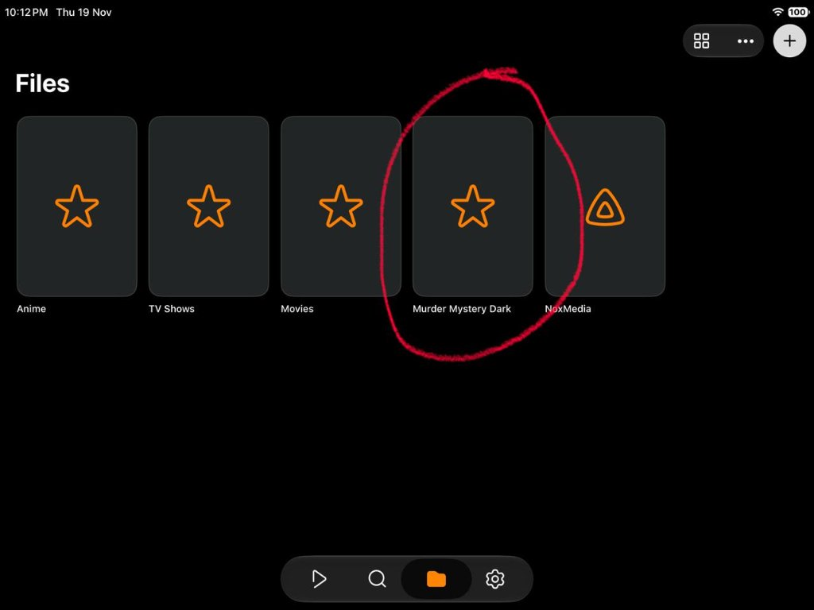
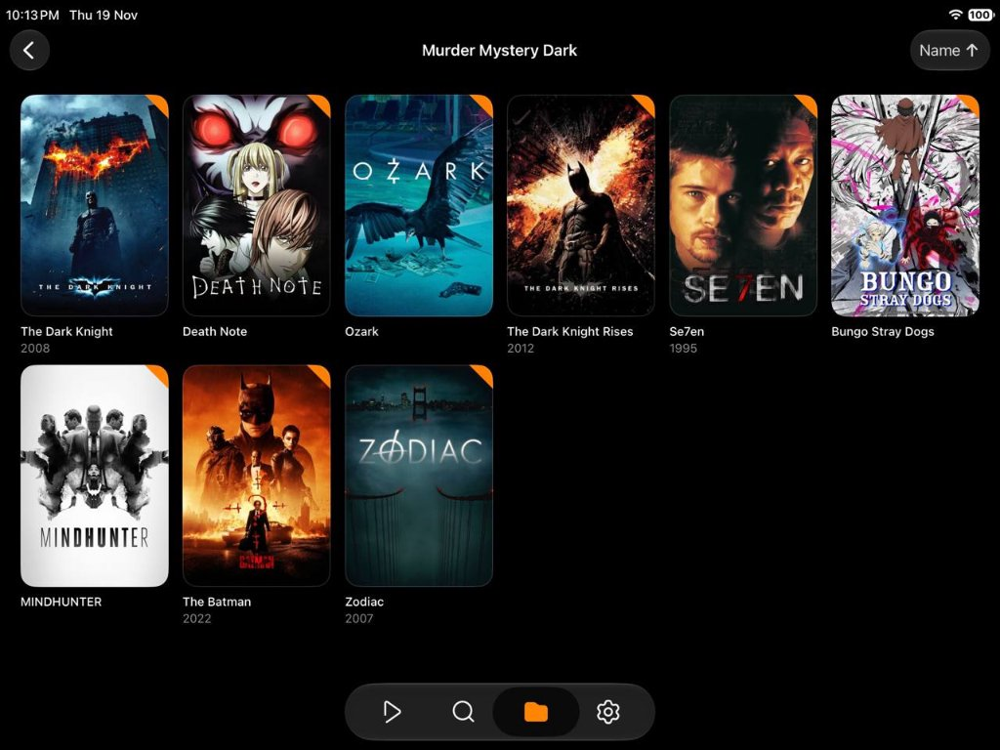

# 🍎 Infuse (Apple TV, iOS & Mac)

NoxMedia features native high-performance integration with [Firecore Infuse](https://firecore.com/infuse), transforming your Telegram channels into an Apple-grade home theater experience.

With NoxMedia's **Emulated Jellyfin Bridge**, you get full DirectPlay capabilities, 4K HDR / Dolby Vision passthrough, Spatial Audio, and instant poster loading.

---

## ⚡ Direct Mode vs. Library Mode

> [!IMPORTANT]
> **Always use Direct Mode (Files browsing)** for the best and fastest experience.
> In Infuse Settings → **Library**, do **not** enable full background indexing on the NoxMedia share. Infuse's standard Library mode attempts to recursively crawl every single item in one go, which can trigger network rate limits. Direct Mode streams metadata on-demand with **0ms instant responses**.

---

## 🛠️ Step-by-Step Setup Guide

### 1. Find Your NoxMedia Server IP
1. Open the NoxMedia app on your host device (Android phone or server).
2. Start the server toggle.
3. Note down the local IP displayed on the home dashboard (e.g., `http://192.168.1.15:8096`).

### 2. Add Jellyfin Share in Infuse
1. Open **Infuse** on your Apple TV, iPhone, iPad, or Mac.
2. Navigate to **Settings** (Gear icon) → **Shares** → **Add Media...**
3. Under *Available Shares*, choose **Other...** or select **Jellyfin**.
4. Fill in the connection credentials:
   - **Protocol**: `Jellyfin` (or `Emby`)
   - **Address**: `192.168.1.15` *(enter your device's actual IP)*
   - **Port**: `8096`
   - **Username**: `NoxMedia` *(or any username)*
   - **Password**: *(leave blank)*
5. Tap **Save / Add**. Infuse will connect to your NoxMedia server instantly.

---

## ⭐ Custom Shelves & Home Screen Favorites

NoxMedia's unique feature is exposing your **AI-curated shelves and custom catalogs** directly inside Infuse.

  
  
Files view in Infuse displaying pinned Favorites and Custom Shelves like "Murder Mystery Dark".

### How to Pin Catalogs to your Home Screen:
1. Open Infuse and navigate to the **Files** tab.
2. Select your **NoxMedia** server.
3. You will see default libraries (**Movies**, **TV Shows**, **Anime**) alongside all your custom catalogs (e.g., *Murder Mystery Dark*, *Oscar Winners 2024*, *Anime Binge*).
4. Long-press (or tap the **Star** icon) on any custom shelf to mark it as a **Favorite**.
5. Once starred, it will appear directly on your Apple TV / iOS **Home Screen carousel** for one-click access!

  
  
Inside the "Murder Mystery Dark" catalog with instant TMDB metadata, high-res posters, and release years.

---

## 🍿 Playback Features

- **DirectPlay Everything**: Infuse handles HEVC, AV1, VP9, H.264, DTS-HD, Dolby TrueHD, and EAC3 natively without server-side transcoding.
- **Multiple Subtitles & Audio Tracks**: Switch between embedded Telegram audio streams and subtitle tracks on the fly.
- **Dolby Vision & HDR10+**: Seamlessly mapped according to your Apple TV and display capabilities.

---

## 🔍 Troubleshooting

<b>Infuse shows a loading spinner on a catalog folder</b>

1. Ensure the NoxMedia app on your host device is running and not put into deep sleep by Android's battery saver.
2. Check that both devices are connected to the same local Wi-Fi / subnet.
3. NoxMedia precomputes media catalogs in memory (`0ms cache`). If you just added a new channel or catalog, pull-down to refresh inside Infuse.

<b>Poster artwork is missing for some items</b>

NoxMedia matches files using TMDB & TVDB IDs. If a Telegram file doesn't have a clear filename, open NoxMedia on your phone, go to **Index**, and use **Manual Match** to assign the correct movie or show.

