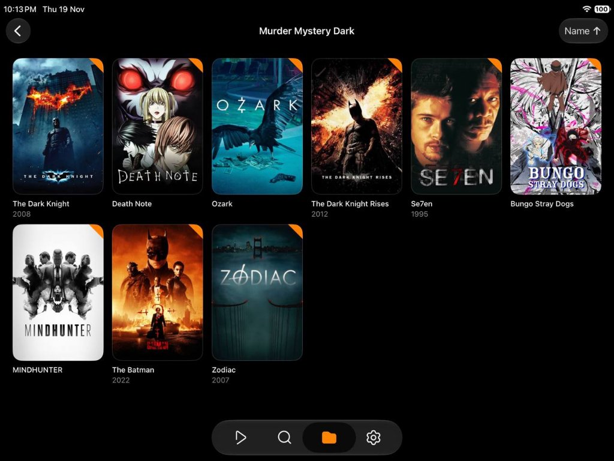

# 🤖 AI & Custom Catalogs

One of NoxMedia's most powerful capabilities is **Dynamic Custom Shelves**. Instead of rigid generic genres, you can create tailored, intelligent collections curated by AI or fine-tuned rules that reflect your exact viewing tastes.

---

## ✨ What are Custom Catalogs?

Custom catalogs are dynamic playlists that index and filter your Telegram library on the fly. 

Examples of popular shelves:
- 🕵️‍♂️ *Murder Mystery & Dark Whodunit*
- 🌌 *Sci-Fi Space Operas & Cyberpunk*
- 🏆 *A24 & Indie Cinema Classics*
- ⚔️ *Shonen Anime with Peak Animation*
- 🍿 *4K Dolby Vision Popcorn Blockbusters*

---

## 🧠 AI-Powered Curation (Gemini & OpenRouter)

NoxMedia integrates directly with large language models to curate playlists from your indexed media:

1. In NoxMedia Settings, add your free **Google Gemini API Key** or **OpenRouter API Key**.
2. Go to **Catalogs** → **Create New Shelf** → **AI Assistant**.
3. Enter your prompt in plain English:
   > *"Find all psychological thrillers, neo-noir, and investigative murder mysteries with dark atmospheres and high suspense."*
4. NoxMedia's AI analyzes your indexed database, cross-references movie themes, plots, and tags, and builds your shelf automatically.

---

## 🛠️ Manual Rule-Based Filters

If you prefer exact granular control, you can create shelves based on rules:

- **Genre Matching**: Include or exclude genres (e.g., `Sci-Fi` + `Thriller`, exclude `Horror`).
- **Resolution & Quality**: Only include `4K UHD` or `HDR10 / Dolby Vision` files.
- **Year & Decades**: Create retro shelves (e.g. *80s Action*, *90s Nostalgia*).
- **Ratings**: Minimum TMDB score (e.g., `Score ≥ 7.5`).
- **Keywords & Directors**: Filter by tags like `Christopher Nolan`, `Studio Ghibli`, `Time Travel`.

---

## 📱 Cross-Client Compatibility

Once a shelf is created in NoxMedia, it is instantly broadcast to all your connected players:

- **Infuse**: Appears as a dedicated folder in **Files → NoxMedia**. Star it to display it directly on your Apple TV / iPad Home Screen.
- **Stremio**: Appears on the **Discover** board and Home tab alongside standard catalogs.
- **Nuvio**: Seamlessly integrates into your custom provider feeds.

  
  
The "Murder Mystery Dark" AI shelf streamed directly inside Infuse on iPad.

