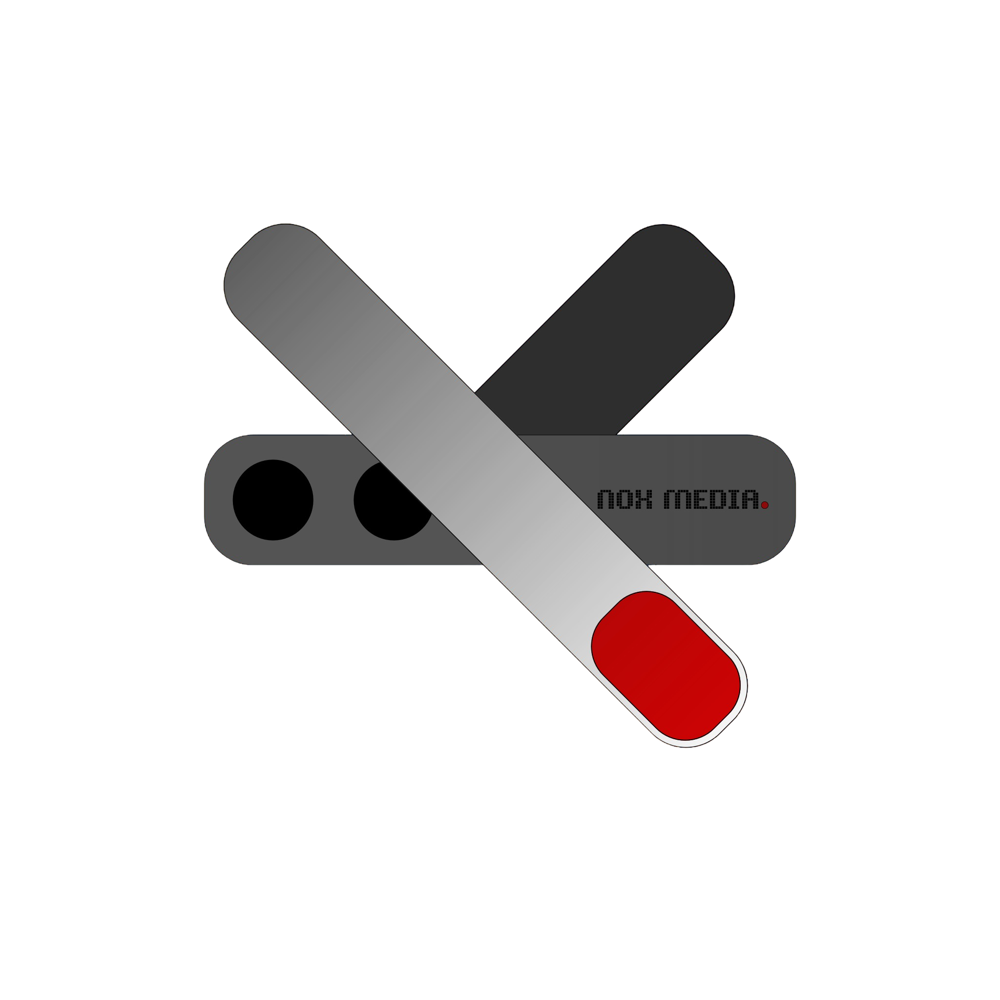

  

    

      
    

    
    <h1 class="hero-title">NoxMedia</h1>
    
Designed for Your Media.

    

      <a href="/guide/getting-started" class="btn-primary">Get Started</a>
      <a href="https://github.com/TheAceOfficials/NoxMedia/releases/latest" class="btn-secondary" target="_blank" rel="noopener">Download App</a>
      <a href="https://www.patreon.com/cw/TheAceOfficials" class="btn-tertiary" target="_blank" rel="noopener">Donation / Support</a>
    

  

  

    

      Copyright &copy; 2026 TheAceOfficials &bull; <a href="https://github.com/TheAceOfficials/NoxMedia/blob/main/LICENSE" target="_blank" rel="noopener">AGPLv3 License</a>
    

    

      Stable: v1.4.320
      Beta: v1.4.325
    

  

