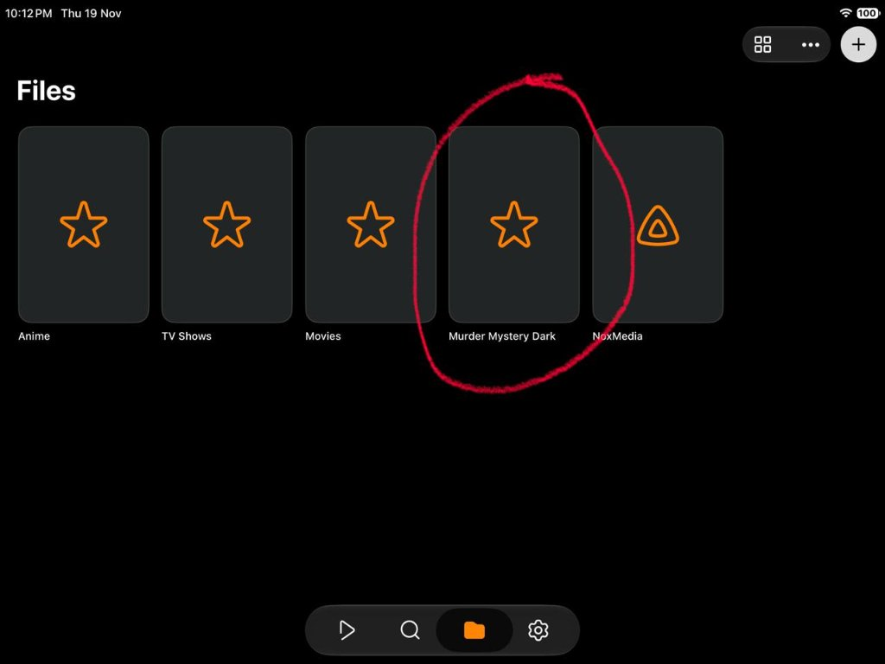

# Release v1.4.325

  Feature
  Performance
  Released on November 19, 2026

## 🍎 Infuse Custom Catalogs & Shelves

In this release, we've brought full support for **Custom AI Shelves directly inside Infuse**!

Previously, Infuse users could only browse the default "Movies", "TV Shows", and "Anime" virtual folders. With v1.4.325, any custom catalog you create inside NoxMedia (such as *Murder Mystery Dark*, *Marvel Universe*, or *Retro Sci-Fi*) is dynamically exposed in the Jellyfin Bridge when Infuse connects.

  
  
Custom shelves like "Murder Mystery Dark" appear alongside default libraries in Infuse Files.

### ⭐ Pinned Favorites on Apple TV & iOS
You can now tap the **Star** icon on any custom shelf to pin it as a Home screen Favorite in Infuse. It will render as a dedicated horizontal carousel on your Apple TV or iPhone/iPad!

  
  
Loaded items with instant high-resolution posters and metadata.

---

## ⚡ 0ms Instant Catalog Caching

### The Problem
When Infuse opens a custom folder, it queries all items in that collection simultaneously. In earlier versions, this required parsing thousands of raw Telegram messages on the fly and doing synchronous HTTP network queries to resolve runtimes, resulting in a 1–2 minute delay.

### The Solution
- **Precomputed In-Memory Cache**: Media groups and catalog filters are precomputed in the background and stored in high-speed RAM and disk cache (`media_groups_cache.json`).
- **Zero-Block HTTP Calls**: Removed synchronous network lookups in `resolveRuntimeSeconds`, relying on pre-cached TMDB metadata and Telegram duration attributes.
- **Results**: Loading a custom shelf with hundreds of movies/episodes in Infuse now takes **0ms (instant)**!
